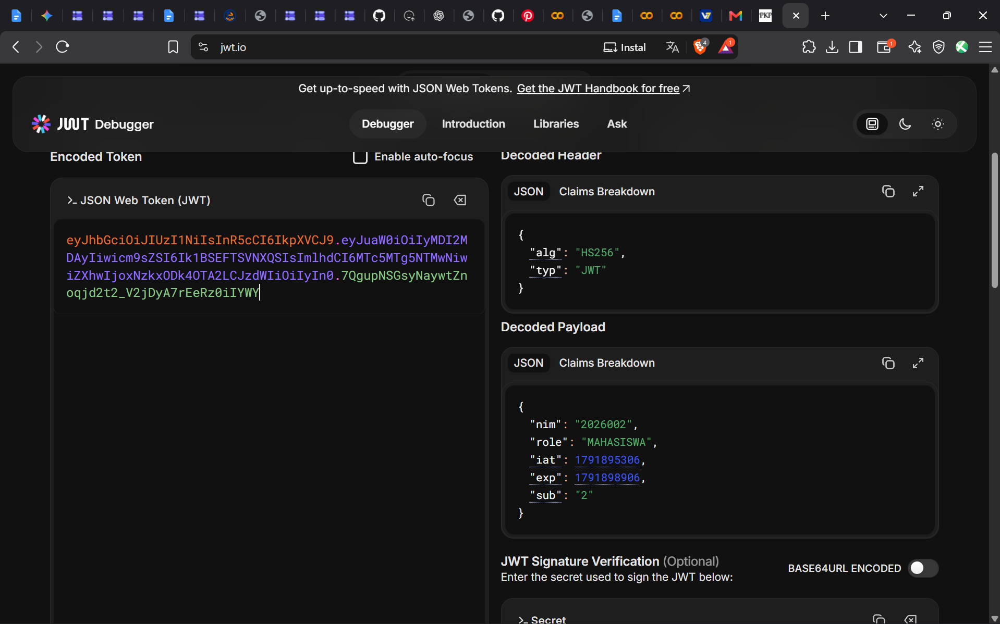
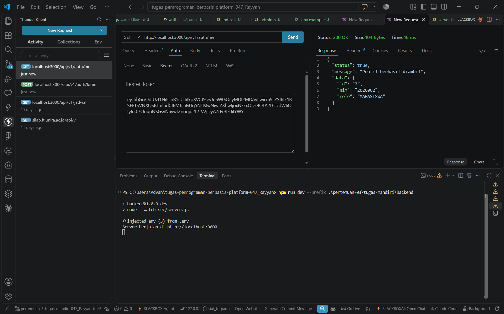
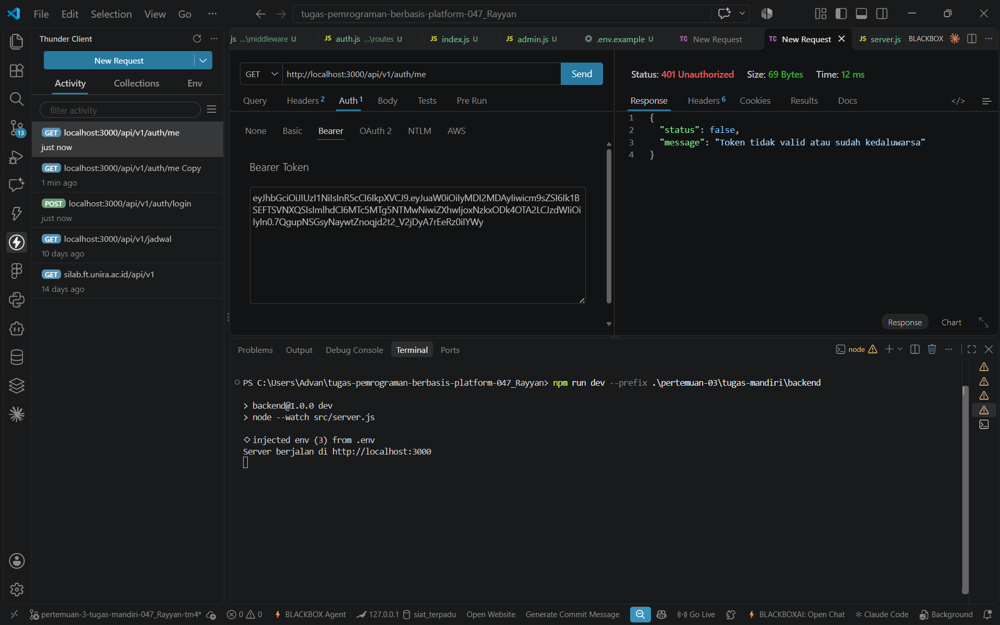

# Tugas Mandiri 4 — Analisis JWT

## 1. Tujuan Pengujian

Pengujian ini bertujuan untuk memahami struktur JSON Web Token (JWT), mengidentifikasi klaim yang terdapat di dalam token, serta menguji validasi token pada endpoint profil pengguna. Pengujian dilakukan menggunakan Thunder Client dan API lokal pada endpoint `GET /api/v1/auth/me`.

## 2. Pengujian Login dan Pemeriksaan Token

Login dilakukan melalui endpoint `POST /api/v1/auth/login` menggunakan akun praktikum mahasiswa dengan NIM `2026002`. Hasil pengujian menunjukkan bahwa server mengembalikan status `200 OK` dan memberikan JWT sebagai bukti autentikasi pengguna.

Token tersebut kemudian digunakan untuk mengakses endpoint `GET /api/v1/auth/me`. Server mengembalikan status `200 OK` dengan informasi profil pengguna berupa ID, NIM, dan peran pengguna (`MAHASISWA`).

**Bukti pengujian:**

*Gambar 1. Payload JWT yang telah diperiksa melalui jwt.io. Token lengkap tidak ditampilkan demi keamanan.*

*Gambar 2. Respons endpoint profil menggunakan token asli dengan status 200 OK.*

## 3. Analisis Klaim JWT

JWT memiliki tiga bagian utama, yaitu header, payload, dan signature. Payload berisi klaim yang menyimpan informasi terkait identitas dan masa berlaku token.

Klaim yang diperiksa dalam pengujian ini adalah:

| Klaim | Fungsi |
|---|---|
| `sub` | Mengidentifikasi subjek atau pengguna yang diwakili oleh token. |
| `role` | Menunjukkan peran pengguna yang dapat digunakan untuk pemeriksaan hak akses. |
| `iat` | Menunjukkan waktu ketika token diterbitkan (*issued at*). |
| `exp` | Menunjukkan waktu kedaluwarsa token (*expiration time*). |

Klaim `sub` digunakan untuk mengidentifikasi pengguna, sedangkan klaim `role` digunakan untuk menentukan peran pengguna dalam pemeriksaan otorisasi. Sementara itu, `iat` menunjukkan waktu penerbitan token dan `exp` menunjukkan batas waktu berlakunya token. Dengan demikian, `iat` berkaitan dengan waktu token dibuat, sedangkan `exp` menentukan kapan token tidak lagi dapat digunakan.

**Catatan:** nilai numerik `iat` dan `exp` perlu dicatat sesuai payload token yang benar-benar diperoleh dari jwt.io.

## 4. Pengujian Token yang Dimodifikasi

Pengujian berikutnya dilakukan dengan mengubah satu karakter pada token tanpa membuat signature baru. Token hasil perubahan kemudian digunakan untuk mengakses endpoint `GET /api/v1/auth/me`.

Hasil pengujian menunjukkan bahwa server mengembalikan status `401 Unauthorized` dengan pesan `Token tidak valid atau sudah kedaluwarsa`.

*Gambar 3. Respons endpoint profil menggunakan token yang telah dimodifikasi dengan status 401 Unauthorized.*

Perubahan karakter menyebabkan token tidak lagi memiliki signature yang sesuai dengan isi token yang ditandatangani sebelumnya. Ketika server memvalidasi token, pemeriksaan signature gagal sehingga permintaan ditolak. Hasil ini menunjukkan bahwa server tidak menerima token yang telah dimodifikasi sebagai token autentikasi yang valid.

## 5. Kesimpulan

Berdasarkan pengujian yang telah dilakukan, login berhasil menghasilkan JWT yang dapat digunakan untuk mengakses profil pengguna melalui endpoint `GET /api/v1/auth/me` dengan status `200 OK`. Setelah satu karakter pada token diubah tanpa menghasilkan signature baru, permintaan memperoleh status `401 Unauthorized`.

Pengujian ini menunjukkan bahwa validasi signature merupakan bagian penting dalam mekanisme autentikasi JWT karena membantu mendeteksi perubahan pada token. Selain itu, klaim `sub`, `role`, `iat`, dan `exp` memiliki fungsi berbeda dalam identifikasi pengguna, pemeriksaan peran, dan pengelolaan masa berlaku token.